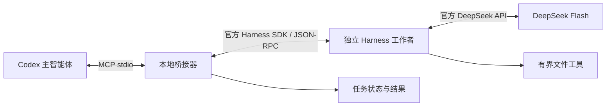

# DeepSeek Harness Bridge 1.1.0

让 Codex 将范围明确的工作委派给独立的 DeepSeek Flash 工作者，再收回结果、检查证据并继续主任务。插件作为 DW Marketplace 的独立条目发布，不改变 development-workflow 或 gpt-bridge 的版本。



这里的“调用 Harness”是通过官方 SDK 启动其独立运行时。插件不控制桌面窗口，不接管已有桌面会话，也不读取桌面保存的登录凭据。需要为 MCP 进程单独配置 API Key。桌面应用无需保持打开。

## 安装与配置

先准备 **Node.js 24.18+** 和 npm。插件源码市场安装不会自动执行 npm；首次安装或更新后，需要在**实际安装的插件目录**安装依赖。不要在未确认的缓存版本中操作。

```sh
npm ci --ignore-scripts --no-audit --no-fund
node launch.js --doctor
```

依赖通过 `npm-shrinkwrap.json` 锁定。官方 SDK 固定为 `@deepseek-ai/dsh-sdk-client@0.2.1-rc.2`，它加载同版本 `@deepseek-ai/dsh`。不使用 npm 的可漂移 latest 标签，不在启动时自动下载安装。`--doctor` 即使缺少依赖也可输出诊断，但退出码 0 只表示诊断运行完成；请检查 Node 支持和依赖状态。

在 Codex 中添加或刷新 `JocuperDARY/dw-marketplace`，安装 `deepseek-harness-bridge`，运行插件的 `deepseek-setup` 技能。市场沿用仓库的 `.claude-plugin/marketplace.json`；当前 Codex 使用插件根目录的 portable `plugin.json` 和 `mcp.json`，通过 `${PLUGIN_ROOT}` 解析启动路径。保留 `.codex-plugin`、`.claude-plugin` 和 `.mcp.json` 兼容清单；各宿主支持分别验证。

支持插件管理命令的 Codex CLI 可在版本发布到市场后使用：

```sh
codex plugin marketplace add JocuperDARY/dw-marketplace
codex plugin add deepseek-harness-bridge@dw-marketplace
```

本地候选测试可将第一条的来源替换为本地市场仓库的绝对路径。运行 `codex mcp get deepseek-harness-bridge --json`，从已展开的 `transport.args` 确认实际安装目录，再在该目录执行 npm ci。`plugin/installed` 的 `source.path` 可能只表示市场来源；不要把源码目录的 node_modules 当成已安装副本的依赖。

MCP 入口使用 `node launch.js`。本机 `config.json` 的 `nodePath` 可指定现有 Node 24.21，由启动器重新执行，无须修改系统 PATH。Windows 可用包内脚本将 API Key 加密保存，详见 [Windows 安装和凭据配置](docs/windows-setup.md)。不要把 Electron 桌面主程序当成 Node。

Codex 的有效 MCP 配置会合并保留的 `.mcp.json` 中 `env_vars` 白名单，以转发 `DEEPSEEK_API_KEY` 等配置。portable stdio schema 不支持 `env_vars`；不要将它移入根目录 `mcp.json`。可用 `codex mcp get deepseek-harness-bridge --json` 核对有效 `transport.env_vars`，不要输出或粘贴凭据值。其他宿主和非 Windows 平台的真实凭据传递需要分别验证。`npm run test:package` 还会生成真实归档并检查 portable 和兼容清单均被打包。

| 环境变量 | 用途 |
| --- | --- |
| `DEEPSEEK_API_KEY` | 由用户在 MCP 进程环境配置；不要放进聊天、仓库、工具参数或共享配置。 |
| `DSH_BRIDGE_CONFIG_DIR` | 本机配置目录；默认 Windows LocalAppData/DeepSeekHarnessBridge，其他系统 ~/DeepSeekHarnessBridge。 |
| `DSH_BRIDGE_DATA_DIR` | 建议显式设置的绝对状态目录，必须与每个任务工作区互不包含。 |
| `PLUGIN_DATA` / `CLAUDE_PLUGIN_DATA` | 未指定状态目录时优先使用的宿主数据根；其下建立 `.deepseek-harness-bridge`。均未提供时使用用户目录下同名子目录。 |

同一数据目录允许多个 MCP 发现连接，但同时只运行一个 Flash 任务；活动任务持有独占锁。若需要不同聊天并行执行 Flash 任务，应配置不同的数据目录和互不冲突的工作区。安装、配置和已连接是三个不同状态；以目标聊天实际列出并可调用 `dsh_doctor` 为连接证据。

## 使用

在已授权 DeepSeek 委派的主任务中调用 `deepseek-delegate`，或让 Codex 按以下工具流程执行。子任务 prompt 包含目标、相关上下文、文件归属、完成条件和所需证据；完整聊天不会自动同步。

调用授权由 Codex/MCP 宿主与主智能体依据用户指令执行。插件不提供独立的用户身份认证或付费许可服务；API Key 存在、插件已安装、模型填写“已批准”均不是用户授权证明。宿主应核对工作区、数据发送、所选能力和预算范围，已有明确授权可在该范围内持续执行。

| MCP 工具 | 作用 |
| --- | --- |
| `dsh_submit` | 提交新任务，立即返回 taskId；同 requestId 和同输入不会重复启动。 |
| `dsh_status` | 查询某次执行状态、终止原因和清理结果。 |
| `dsh_list` | 按最近一次执行的开始时间列出最多 50 项任务，便于恢复 taskId。 |
| `dsh_wait` | 等待最多 30 秒并返回简短状态。 |
| `dsh_result` | 按页读取最终或失败结果；用 nextOffset 继续。 |
| `dsh_continue` | 续接已完成任务；预算编排任务也可从安全暂停的检查点恢复，总预算不会重置。 |
| `dsh_cancel` | 关闭该任务的 SDK 运行时，确认清理；保留部分修改。 |
| `dsh_doctor` | 检查配置和依赖，不调用模型，也不输出密钥。 |
| `dsh_capabilities` | 只读盘点已安装 DSH 包和显式配置的能力 profile；按任务选择最小能力集合。 |

示例任务参数，工作区应替换成实际存在的独立目录：

```json
{
  "requestId": "docs-review-001",
  "workspace": "D:\\worktrees\\docs-review",
  "prompt": "检查 docs/ 中的接口说明是否与 src/ 一致。仅阅读文件，返回差异、文件路径和证据。其他智能体可能同时工作，不修改或覆盖他们的内容。没有执行测试时明确说明。",
  "access": "read-only",
  "executionMode": "budgeted",
  "workload": "standard",
  "timeoutMs": 300000,
  "maxTokens": 8192,
  "maxToolCalls": 32,
  "maxModelRequests": 6,
  "maxRequestBytes": 262144,
  "capabilityProfile": "files",
  "budget": {
    "totalModelRequests": 32,
    "totalOutputTokens": 65536,
    "totalToolCalls": 64,
    "totalDurationMs": 1200000
  }
}
```

主智能体收到 taskId 后继续独立工作，随后等待和取回结果。插件不主动向 Codex 聊天发送消息，也不能唤醒已经结束的主回合。执行中不支持插入消息；成功结束或编排任务安全暂停后可以续接，急需改方向时取消并提交明确的新任务。

### 在总预算内自动分阶段推进

新任务默认使用 `executionMode: budgeted`，必须提供 `budget` 的四项预授权总额度。遗漏时返回 `BUDGET_REQUIRED`，不启动工作者。上例的总额度覆盖整个逻辑任务：最多 32 次模型请求、65,536 输出 token、64 次工具调用和 20 分钟。这些只是参数示例，不会自动执行；必须根据已有授权填写，不能把示例当成授权。只有一次自包含文本推理才使用显式 `single-request`：inference-only、read-only、零工具且不能续接。

```json
{
  "budget": {
    "totalModelRequests": 32,
    "totalOutputTokens": 65536,
    "totalToolCalls": 64,
    "totalDurationMs": 1200000
  }
}
```

`maxModelRequests`、`maxTokens`、`maxToolCalls`、`timeoutMs` 是阶段或单请求上限。桥接器从剩余总额度分配阶段预算，预留一次请求及最多 2048 输出 token 保存进度，其余工作请求按剩余额度动态分配。显式 `maxTokens` 不会被擅自提高。收尾请求使用 `off` 并禁用工具，减少推理挤占正文的风险。检查点保存、消耗登记和进程清理确认后自动开始下一阶段；各阶段使用新的隔离 SDK 会话，不复用其他桌面对话。

`dsh_status` / `dsh_result` 的 `orchestration` 显示授权、已计入消耗、剩余额度、阶段数和检查点路径。总额度无法再支持工作及进度保存时返回 `paused` / `TOTAL_BUDGET_EXHAUSTED`；重复相同进度返回 `paused` / `NO_PROGRESS`。重启、幂等重放和 `dsh_continue` 都不会补充额度或延长原截止时间。需要扩大预算时由主智能体取得新授权后建立新任务。

未知用量按预留上限计入；无效回执保留整阶段预留额度。输出 token 包含推理，不是金额或精确输入 token 上限。供应商 `max-tokens` 会保留部分正文到 `partial-N.json`；仅在清理和记账确认后，允许从同一总预算执行一次 `off`、零工具的恢复请求。它重新生成有效阶段 JSON，不拼接残缺 JSON，也不重复文件操作。整个任务最多一次截断恢复；其他失败不自动重试。预算不足、再次截断、格式错误或清理失败都保留非成功状态。详见[1.0.0 预算可靠性契约](docs/budget-reliability.md)。

插件固定路由为 `deepseek-official / deepseek-flash`。锁定 SDK 的目录将别名标为 DeepSeek-V4.1-Flash；实际服务版本以提供方为准。工作类型 `mechanical`（字面提取/格式转换）默认 off/4096，`standard`（一般维护）默认 low/8192，`reasoning` 默认 high/16384；路径分类、例外优先级和测试预期使用 `verification`，默认 high/16384，必须提供 `reviewContract`。可显式指定 off/low/high/max，max 默认 32768；低档位和小额度覆盖会保留并给出相关提示，不扩大已授权预算。检查点和恢复请求使用 off。模型能力、200 tok/s 和整体加速效果需要真实测量，这些默认值不代表性能保证，也不修改宿主模型白名单。

### 验证类委派与内容验收

有限表格也可能包含规则推理，不能因为行数少就称为 mechanical。为规则标记 ID，并在 `reviewContract` 列出全部 `caseIds`、已给定的 `ruleIds`、必须完成的 `checkIds`（没有额外检查时显式填空数组）。未指定 workload 的清单任务默认 verification。插件要求每项分类、依据、适用规则、预期和不确定性，以及每项检查的独立结果；详见[委派质量契约及示例](docs/delegation-quality.md)。

`deliveryValidation` 检查 ID 覆盖、重复、字段和规则引用，不判断分类和算术是否正确。`structure_complete` 仍保持 `parentAcceptance: not_assessed`；父级必须独立核验路径边界、例外与分类是否混淆、阈值及必做算术，再决定能否作为测试预期。运行完成、结构完整和内容验收分别记录，缺项和质量失败不会自动触发新的模型请求。原始文本保留，不修补残缺 JSON 或覆盖历史失败。

## 工作区、预算和状态

默认 `files` profile 的 read-only 提供 `bridge_list`、`bridge_read`。workspace-write 增加 `bridge_write`，覆盖需提交刚读到的 sha256，并备份原内容；创建使用 `expectedSha256: "new"`。`inference-only` 不加载文件工具。默认不提供删除、创建目录、终端、联网工具、测试执行或子智能体；由主智能体完成这些操作。

已有 dsh 插件可通过显式本机 capability profile 选择经过审查的 headless 模块和少量技能。按安装版本盘点、提交时固定配置摘要、每次启动验证文件哈希及实际工具集合。不会因桌面“已安装”就自动挂载整套插件。适配方式和第三方代码边界见 [能力选择](docs/capabilities.md)。

文件工具限制为单目录最多扫描 1000 个条目、单个 UTF-8 文件/写入最多 256 KiB，拒绝路径穿越、符号链接、junction、硬链接文件和常见配置/凭据目录。过滤路径不是任意秘密内容识别器；任务工作区只应包含允许发送给 DeepSeek 的资料。该边界由工具代码实施，不是操作系统沙箱，也不能抵御其他本地进程恶意并发替换路径。写任务使用独立副本或 worktree，避免两个工作者同时写同一文件。

读取按最多 16384 个 UTF-16 字符分页，`sha256` 覆盖完整文件，`nextOffset` 指示下一页；任务累计历史仍受请求字节预算约束。写入先完成同目录临时文件，再原子发布；同一工作区的桥接写入方共享 `.dsh-bridge-write.lock`。锁不会自动抢占，异常退出后须核实现场再处理。该锁不约束外部编辑器或第三方工具，哈希检查与发布也不是针对所有进程的通用 CAS；文件归属和独立副本仍必需。

默认阶段时限 5 分钟（1 秒至 30 分钟）；maxToolCalls 默认 32，inference-only 默认 0；maxTokens 范围 256–32768；maxModelRequests 默认 6（编排阶段 2–128），单请求模式固定为 1；maxRequestBytes 默认 262144（1024–1048576）。请求在 adapter 前受次数、路由、字节数和输出配置约束，初始化禁止消费。标题请求、自动压缩和供应商通用失败重试关闭。每项任务最多 16 次父级 attempt，新多阶段任务始终使用同一总预算；旧记录保留原规则用于兼容。状态最多 1000 项任务；prompt 最多 64 KiB，结果最多 1 MiB，单页最多 32000 个 UTF-16 code units；取消后的清理可能多用数秒。

只有当前 prompt 回执、`session/wait`、`turn/end: completed`、非空结果和确认的进程退出都成立时才报告 completed；编排还验证阶段 JSON。parentAcceptance 由主智能体判断。`output.kind` 区分完整正文、部分正文、仅推理、空输出；`output.modelTruncated` 表示供应商截断，`outputTruncated` 仅表示存储裁剪。`resultAvailable`、`nextOffset: null` 都不能证明完成。若截断恢复成功，仍保留原失败证据和恢复回执；其他错误如实报告。取消不回滚已写文件。

任务元数据与结果写入状态目录；Harness 在每项任务的隔离 home 中保存会话历史和工具记录，方便成功后的续接。不要把该目录提交到仓库或随插件打包。桥接器不把原始 provider stderr 返回给模型；错误使用固定类别。MCP 的配置诊断成功不等于 API Key 有效或付费推理成功。

## 异常退出与恢复

MCP 握手、工具发现、doctor 和 capabilities 不独占状态目录。任务工具按需取得 owner.lock，活动任务和自动阶段之间保持独占，结果持久化且清理确认后释放。观察操作遇到短暂冲突最多等待 1500 ms，`dsh_wait` 与原超时共用此额度；仍冲突时返回 `STATE_LOCKED`、`operation: observation` 和重试间隔。仅重试原读取，不重新提交或消费。持续冲突需核对持有者，不能删除锁；这不证明旧持有者是否仍存活。新的预算阶段使用隔离 SDK 会话，不影响其他桌面对话。

正常关闭会先取消该连接的活动任务、等待 SDK 进程退出，再释放 owner.lock。无法确认清理或写入失败时保留锁并阻止新任务。已有锁不会因为 PID 不存在就被自动删除。

发生 STATE_LOCKED / RECOVERY_REQUIRED 时，保留状态目录，检查是否还有桥接进程及其所属 Harness 运行时；先核实进程身份并完成清理，必要时由操作者归档整个状态目录。确认旧资源均已停止后再建立新的数据目录继续。不要把删除锁当成自动修复。旧结果仍可由操作者从 task.json 和 result-N.txt 取回；未完成任务不得自动续跑。

## 验证和维护

```sh
npm test
```

测试覆盖任务持久化和幂等、并发限制、续接、超时/取消、失败清理、路径边界、预算账本及检查点恢复。编排集成测试使用真实 MCP 与官方 SDK 运行时、本地合成模型流，并在子进程禁止网络连接；其模拟请求计数不代表真实付费请求。其余测试使用假运行时或无推理初始化，均不调用真实模型。应分别记录付费 Flash 调用、真实 Codex 安装/加载和各操作系统的验证结果。

设计契约见 [docs/design.md](docs/design.md)。官方参考：[Harness SDK](https://github.com/deepseek-ai/deepseek-harness/blob/master/packages/sdk/client/README.md)、[SDK 协议](https://github.com/deepseek-ai/deepseek-harness/blob/master/packages/sdk/protocol/README.md)、[Codex 插件打包](https://developers.openai.com/plugins/build/plugins)、[本地 MCP 插件](https://developers.openai.com/plugins/deploy/desktop-only)。
