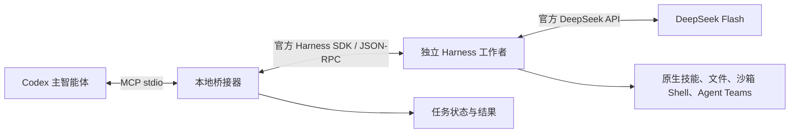

# DeepSeek Harness Bridge 2.0.4

2.0.4 修复原生 Teams 的共享阶段检查点：父任务保留收尾请求，停止并回收所属子任务，保存真实终态和迟到的结算通知。Windows 回执原子替换仅对短暂共享冲突做有限重试。增加真实 SDK 内的离线文件、技能、Shell/jobs、会话恢复和 Teams 验证；模型流为合成数据，不代表真实 Flash 质量或费用。见[原生执行与检查点验证](docs/native-validation.md)。

2.0.3 修复 OBS-1 备份完整性和 OBS-2 Team 状态文件工具边界：发布目标前验证原内容备份，同名损坏或链接备份明确失败并保留证据；内建文件工具在任意深度及大小写下隐藏并拒绝 `.agent-teams-bridge`。原生 Team 工具继续直接维护状态。保留 2.0.2 的委派依据与父级验收规则。

2.0.2 完善通用审核委派中的规则来源、前置条件依据、通用规则与数值实例区分，以及父级逐条验收；包含 2.0.1 的 native 文件边界修复。离线合成案例不证明真实模型质量提高。见[委派模板与验收规则](docs/delegation-quality.md)。

2.0.1 发布已通过独立离线复核的 native 文件边界修复：文件读写使用任务工作区保护，只读不注册 ops_replace。保留 2.0.0 的原生技能、未指定资源额度和持续进度；native 文件能力统一采用 bridge 工作区保护。明确预算、单请求禁止重试、旧任务兼容和独立内容验收边界继续保留。

让 Codex 将范围明确的工作委派给独立的 DeepSeek Flash 工作者，再收回结果、检查证据并继续主任务。插件作为 DW Marketplace 的独立条目发布，不改变 development-workflow 或 gpt-bridge 的版本。



这里的“调用 Harness”是通过官方 SDK 启动其独立运行时。插件不控制桌面窗口，不接管已有桌面会话，也不读取桌面保存的登录凭据。需要为 MCP 进程单独配置 API Key。桌面应用无需保持打开。

OBS-1 / OBS-2 加固与证据边界见[能力说明](docs/capabilities.md#obs-1--obs-2-后续加固)。这是内建文件工具的已知名称策略，具有相应权限的 Shell 和受信任自定义模块仍可访问工作区内状态；真实模型质量、Shell 隔离和付费 Teams 推理须有各自证据。

## 安装与配置

先准备 **Node.js 24.18+** 和 npm。插件源码市场安装不会自动执行 npm；首次安装或更新后，需要在**实际安装的插件目录**安装依赖。不要在未确认的缓存版本中操作。

```sh
npm ci --ignore-scripts --no-audit --no-fund
node launch.js --doctor
```

依赖通过 `npm-shrinkwrap.json` 锁定。官方 SDK 固定为 `@deepseek-ai/dsh-sdk-client@0.2.1-rc.2`，它加载同版本 `@deepseek-ai/dsh`。不使用 npm 的可漂移 latest 标签，不在启动时自动下载安装。`--doctor` 即使缺少依赖也可输出诊断，但退出码 0 只表示诊断运行完成；请检查 Node 支持和依赖状态。

在 Codex 中添加或刷新 `JocuperDARY/dw-marketplace`，安装 `deepseek-harness-bridge`，运行插件的 `deepseek-setup` 技能。市场沿用仓库的 `.claude-plugin/marketplace.json`；当前 Codex 使用插件根目录的 portable `plugin.json` 和 `mcp.json`，通过 `${PLUGIN_ROOT}` 解析启动路径。保留 `.codex-plugin`、`.claude-plugin` 和 `.mcp.json` 兼容清单；各宿主支持分别验证。

支持插件管理命令的 Codex CLI 可在版本发布到市场后使用：

```sh
codex plugin marketplace add JocuperDARY/dw-marketplace
codex plugin add deepseek-harness-bridge@dw-marketplace
```

本地候选测试可将第一条的来源替换为本地市场仓库的绝对路径。运行 `codex mcp get deepseek-harness-bridge --json`，从已展开的 `transport.args` 确认实际安装目录，再在该目录执行 npm ci。`plugin/installed` 的 `source.path` 可能只表示市场来源；不要把源码目录的 node_modules 当成已安装副本的依赖。

MCP 入口使用 `node launch.js`。本机 `config.json` 的 `nodePath` 可指定现有 Node 24.21，由启动器重新执行，无须修改系统 PATH。Windows 可用包内脚本将 API Key 加密保存，详见 [Windows 安装和凭据配置](docs/windows-setup.md)。不要把 Electron 桌面主程序当成 Node。

Codex 的有效 MCP 配置会合并保留的 `.mcp.json` 中 `env_vars` 白名单，以转发 `DEEPSEEK_API_KEY` 等配置。portable stdio schema 不支持 `env_vars`；不要将它移入根目录 `mcp.json`。可用 `codex mcp get deepseek-harness-bridge --json` 核对有效 `transport.env_vars`，不要输出或粘贴凭据值。其他宿主和非 Windows 平台的真实凭据传递需要分别验证。`npm run test:package` 还会生成真实归档并检查 portable 和兼容清单均被打包。

| 环境变量 | 用途 |
| --- | --- |
| `DEEPSEEK_API_KEY` | 由用户在 MCP 进程环境配置；不要放进聊天、仓库、工具参数或共享配置。 |
| `DSH_BRIDGE_CONFIG_DIR` | 本机配置目录；默认 Windows LocalAppData/DeepSeekHarnessBridge，其他系统 ~/DeepSeekHarnessBridge。 |
| `DSH_BRIDGE_DATA_DIR` | 建议显式设置的绝对状态目录，必须与每个任务工作区互不包含。 |
| `PLUGIN_DATA` / `CLAUDE_PLUGIN_DATA` | 未指定状态目录时优先使用的宿主数据根；其下建立 `.deepseek-harness-bridge`。均未提供时使用用户目录下同名子目录。 |

同一数据目录允许多个 MCP 发现连接，但同时只运行一个 Flash 任务；活动任务持有独占锁。若需要不同聊天并行执行 Flash 任务，应配置不同的数据目录和互不冲突的工作区。安装、配置和已连接是三个不同状态；以目标聊天实际列出并可调用 `dsh_doctor` 为连接证据。

## 使用

在已授权 DeepSeek 委派的主任务中调用 `deepseek-delegate`，或让 Codex 按以下工具流程执行。子任务 prompt 包含目标、相关上下文、文件归属、完成条件和所需证据；完整聊天不会自动同步。

调用授权由 Codex/MCP 宿主与主智能体依据用户指令执行。插件不提供独立的用户身份认证或付费许可服务；API Key 存在、插件已安装、模型填写“已批准”均不是用户授权证明。宿主应核对工作区、数据发送、所选能力和预算范围，已有明确授权可在该范围内持续执行。

| MCP 工具 | 作用 |
| --- | --- |
| `dsh_prepare_workspace` | 零模型调用创建一个新的独立目录，由 Bridge 工作者账户持有；拒绝接管现有目录或改写其 ACL。Windows 原生 Shell 任务先准备工作区。 |
| `dsh_submit` | 提交新任务，立即返回 taskId；同 requestId 和同输入不会重复启动。 |
| `dsh_status` | 查询某次执行状态、终止原因和清理结果。 |
| `dsh_list` | 按最近一次执行的开始时间列出最多 50 项任务，便于恢复 taskId。 |
| `dsh_usage` | 汇总当前状态目录全部保留任务或一个 taskId 的实际回报 token、缺失项和请求记录；与预算保留额分开。零模型调用。 |
| `dsh_wait` | 等待最多 30 秒并返回简短状态。 |
| `dsh_result` | 按页读取最终或失败结果；用 nextOffset 继续。 |
| `dsh_continue` | 续接已完成任务；预算编排任务也可从安全暂停的检查点恢复，总预算不会重置。 |
| `dsh_cancel` | 关闭该任务的 SDK 运行时，确认清理；保留部分修改。 |
| `dsh_doctor` | 检查配置和依赖，不调用模型，也不输出密钥。 |
| `dsh_capabilities` | 只读盘点已安装 DSH 包和显式配置的能力 profile；按任务选择最小能力集合。 |

示例任务参数，工作区应替换成实际存在的独立目录：

```json
{
  "requestId": "docs-review-001",
  "workspace": "D:\\worktrees\\docs-review",
  "prompt": "检查 docs/ 中的接口说明是否与 src/ 一致。仅阅读文件，返回差异、文件路径和证据。其他智能体可能同时工作，不修改或覆盖他们的内容。没有执行测试时明确说明。",
  "access": "read-only",
  "executionMode": "budgeted",
  "workload": "standard",
  "timeoutMs": 300000,
  "maxTokens": 8192,
  "maxToolCalls": 32,
  "maxModelRequests": 6,
  "maxRequestBytes": 262144,
  "capabilityProfile": "files",
  "budget": {
    "totalModelRequests": 32,
    "totalOutputTokens": 65536,
    "totalToolCalls": 64,
    "totalDurationMs": 1200000
  }
}
```

主智能体收到 taskId 后继续独立工作，随后等待和取回结果。插件不主动向 Codex 聊天发送消息，也不能唤醒已经结束的主回合。执行中不支持插入消息；成功结束或编排任务安全暂停后可以续接，急需改方向时取消并提交明确的新任务。

优先委派可独立验收的完整工作包，例如一个归属明确的模块及测试草稿、多文件证据梳理、完整规则和测试矩阵。只重写两段话或复制少量字段可能不值得委派，但插件不会强制最低 token 消耗，也不会为了增加用量扩大任务。比较效率时计入准备上下文、验收、纠错和集成成本，详见[事实与用量契约](docs/evidence-usage.md)。

### 在总预算内自动分阶段推进

新任务未提供 budget 时默认 `executionMode: automatic`。省略 maxTokens、maxModelRequests、maxToolCalls、maxRequestBytes、timeoutMs 时保持未指定，不再自动填入有限额度；null 同义。提供 budget 自动选择 budgeted，其中只约束明确给出的总额度。上例只是有限预算示例，不能当成授权。`single-request` 始终固定一次 inference-only、read-only、零工具，禁止恢复和续接。

```json
{
  "budget": {
    "totalModelRequests": 32,
    "totalOutputTokens": 65536,
    "totalToolCalls": 64,
    "totalDurationMs": 1200000
  }
}
```

`maxModelRequests`、`maxTokens`、`maxToolCalls`、`timeoutMs` 是阶段或单请求上限。桥接器从剩余总额度分配阶段预算，预留一次请求及最多 2048 输出 token 保存进度，其余工作请求按剩余额度动态分配。显式 `maxTokens` 不会被擅自提高。收尾请求使用 `off` 并禁用工具，减少推理挤占正文的风险。检查点保存、消耗登记和进程清理确认后自动开始下一阶段；各阶段使用新的隔离 SDK 会话，不复用其他桌面对话。

`dsh_status` / `dsh_result` 的 `orchestration` 显示授权、已计入消耗、剩余额度、阶段数和检查点路径。总额度无法再支持工作及进度保存时返回 `paused` / `TOTAL_BUDGET_EXHAUSTED`；重复相同进度返回 `paused` / `NO_PROGRESS`。重启、幂等重放和 `dsh_continue` 都不会补充额度或延长原截止时间。需要扩大预算时由主智能体取得新授权后建立新任务。

未知用量按预留上限计入；无效回执保留整阶段预留额度。输出 token 包含推理，不是金额或精确输入 token 上限。新 budgeted 任务在工作和检查点仍能容纳时，另行软预留一次请求和最多 2048 输出 token；最后普通阶段可释放软预留，硬总额始终不变。确认的 `max-tokens` 和显式检查发现的最终 JSON 格式失败，共享整个任务最多一次 `off`、零工具恢复。先保存原始失败到 `partial-N.json`，确认清理和记账后，从同一总预算重新生成；不拼接残缺文本或重复文件操作。单请求、语义错误、传输/清理/记账/持久化失败不触发此恢复。小预算、耗尽时间和再次失败仍可能无法交付。详见[预算可靠性契约](docs/budget-reliability.md)与[严格交付恢复契约](docs/output-recovery.md)。

插件固定路由为 `deepseek-official / deepseek-flash`。锁定 SDK 将别名标为 DeepSeek-V4.1-Flash；实际服务版本以提供方为准。mechanical/drafting 默认 off，standard 默认 low，reasoning/verification 默认 high；verification 必须提供 reviewContract。推理档位不再暗中设置输出上限；显式档位和额度优先。检查点与交付恢复使用 off。原生压缩请求的 effort 未指定时如实记录 null。模型能力、200 tok/s 和加速效果仍须真实测量。

### 验证类委派与内容验收

简短的已知事实文案可选择 `drafting`，默认 off 且不额外设置输出上限；规则推理仍使用 verification。显式档位和上限优先，包括 low 在内的推理都可能耗尽输出而没有正文。单请求的此类风险会显示为提示，不会自动增加第二次调用。

所有 JSON-only 委派（包括 mechanical 字面提取）应显式设置 `outputFormat: "json-object"`。`reviewContract` 自动要求该格式。完成阶段的整个 summary 字符串只能包含目标 JSON 对象，不能添加说明或围栏；检查点 summary 可保存普通进度。`outputValidation` 独立返回 valid、invalid、not_requested 或 not_evaluated；只验证完整 JSON 及对象根类型，不自动提取子串、修改转义或证明字段值正确。失败恢复后的结果仍须通过同样检查；原始失败不会被覆盖。

有限表格也可能包含规则推理，不能因为行数少就称为 mechanical。为规则标记 ID，并在 `reviewContract` 列出全部 `caseIds`、已给定的 `ruleIds`、必须完成的 `checkIds`（没有额外检查时显式填空数组）。未指定 workload 的清单任务默认 verification。插件要求每项分类、依据、适用规则、预期和不确定性，以及每项检查的独立结果；详见[委派质量契约及示例](docs/delegation-quality.md)。

`deliveryValidation` 检查 ID 覆盖、重复、字段和规则引用，不判断分类和算术是否正确。`structure_complete` 仍保持 `parentAcceptance: not_assessed`；父级必须独立核验路径边界、例外与分类是否混淆、阈值及必做算术，再决定能否作为测试预期。运行完成、格式、结构完整和内容验收分别记录，缺项和语义失败不会自动触发新的模型请求。not_requested 和零问题数不等于检查通过；对路径等字面值比较实际解码后的类型与字符，不依据多层转义显示判断错误。原始文本保留，不修补残缺 JSON 或覆盖历史失败。

## 工作区、预算和状态

报告类任务可提供 `reportContract`，逐项标明 limit、observation 或 execution-status、原值、单位和来源；它默认 drafting/off 并要求返回 `{facts, prose}` JSON。不能与另一种输出形状的 reviewContract 同用。预算上限不代表实际耗时或 RSS，NOT_RUN 不代表已执行，给工作者的写作指令也不是实验事实。`reportValidation` 只检查事实表的覆盖、角色和字面值；`facts_preserved` 仍须逐句核验正文，`proseAcceptance` 与 `parentAcceptance` 保持 not_assessed。事实或语义错误不自动重试。示例与边界见[事实与用量契约](docs/evidence-usage.md)。

公开 schema 按 kind 区分事实：`execution-status.value` 必须是含非空白字符的字符串；数字 `0` 不能充当执行状态。`limit` 和 `observation` 保留字符串、数字、布尔值或 null；插件不自动改 kind、转换值或修补来源。所有事实的 source 必须含非空白字符。reviewContract 的 ID 数组通过 `uniqueItems` 公布唯一性。reportContract 的 `facts[].id` 唯一性以及 JSON 序列化后最多 16384 UTF-8 字节，是 schema 描述中明示的额外契约检查；标准 JSON Schema 无法完整表达这两项检查。

参数拒绝仍返回 `INVALID_ARGUMENT`，并在文本 JSON 和 `structuredContent` 中返回相同的 `error.validation`：`phase` 区分 `schema` 与额外 `contract` 检查，`issues` 包含字段路径数组、代码和固定安全提示。例如执行状态填入数字时，路径是 `["reportContract","facts",3,"value"]`、代码是 `invalid_type`、提示是 `Expected string.`。最多返回 16 项，超出时标记 `issuesTruncated`；不回显字段值、未知字段名、prompt、工作区路径或底层异常。无效报告/审查契约在取得任务状态锁、检查凭据或启动模型之前拒绝。通过这些参数检查仍不证明工作区、执行策略或内容语义可被接受。

查看消费应调用 `dsh_usage`，并同时报告 `tokens.*.reported`、`missingCalls` 和 `unknownReceiptGroups`。新阶段分别持久化请求回执，失败和恢复也计入；汇总不会把最终 attempt 重复计作最后一个阶段。历史缺失阶段保持未知，`orchestrationCharged` 是保守预算扣账，不能充当实测用量。reasoning/cache 是 SDK 上报的组成项，不能再次加到 totalTokens。工具只覆盖本地保留记录，不查询账户账单或推断金额。

`dsh_doctor.validation.modelCalls: 0` 仅指本次诊断没有模型调用。独立工作者的消费不会自动计入桌面对话账本或挂件；本版本提供桥接器侧汇总，不在未确认账户身份、缓存口径和去重方式时自动改写桌面 cost-meter 数据。

新任务默认 native profile：read-only 选择 skills/files，workspace-write 可选择 skills/files/shell/teams；nativePlugins 可明确选择子集。只读不会加载 Shell 或 Agent Teams。native 优先搜索 DSH 技能元数据，再按需加载正文；补充 Codex 来源前必须记录原生搜索与不适用理由。files profile 继续提供 bridge_list/read 和可选 bridge_write，inference-only 不加载工具。bridge_write 仍要求哈希检查并备份原内容。

Windows 原生 Shell 在模型启动前核对工作区所有者和 reparse 祖先。Codex 创建的目录可能属于其沙箱账户，而不是 Bridge 账户；此时用 `dsh_prepare_workspace` 创建新路径，不修改旧目录权限。技能查询的匹配数与来源目录总数分别报告；查询为零不证明技能库为空，可用 `query: "*"` 分页盘点。官方 preset 解析若来自锁定 Bridge SDK，会明确标记来源，不能称为桌面已加载。工具缺少 post-execute 回执时保留 `unobserved`，不补算成功。

native 适配本机 Skills Manager 的 headless provider、dsh-ops 的 Shell runtime 选择、官方 PowerShell 沙箱及 Agent Teams in-process provider。入口固定哈希，原生包的 @deepseek-ai 依赖绑定到 Bridge 锁定的 SDK，避免另一缓存版本破坏成员角色协议。团队状态位于任务专属目录，不复用桌面对话。结果分别保存实际注册工具、调用计数、工具结果状态和技能加载依据；returned 与 loaded 均不代表语义验收通过。其他插件仍需显式适配；见[能力选择](docs/capabilities.md)。

native 的 `files` 选择在两种访问模式中都使用 `bridge_list/read`，相对路径基准始终为任务工作区，不取 SDK 的 worker home。绝对路径、父路径、symlink/junction、硬链接文件和已知 protected name 按现有 bridge 文件规则拒绝。原始 dsh-ops inspect/glob/grep/replace 组件不再挂载，显式 `nativePlugins: ["files"]` 也不会重新打开它。

workspace-write 另提供 bridge 维护的 `ops_replace`：仅对一个既有 UTF-8 普通文件进行全部匹配的字面替换，须传入 `bridge_read` 的整文件 `expectedSha256`，并复用 CAS 和原文备份。文件沿用 256 KiB 边界；操作读取完整文件，不能只改第一页。它不支持 regex、glob、目录递归或 dryRun，也不允许写工作区外的临时目录；并非第三方同名工具的完整兼容实现。read-only 不注册此工具。技能来源和显式 Shell/Team 能力有各自的访问契约；文件保护不是任意代码的 OS 沙箱，也不扫描普通文件正文中的秘密。

内建 bridge_* 文件工具限制为单目录最多扫描 1000 个条目、单个 UTF-8 文件/写入最多 256 KiB，拒绝路径穿越、符号链接、junction、硬链接文件和常见配置/凭据目录。过滤路径不是任意秘密内容识别器；任务工作区只应包含允许发送给 DeepSeek 的资料。该边界由工具代码实施，不是操作系统沙箱，也不能抵御其他本地进程恶意并发替换路径。写任务使用独立副本或 worktree，避免两个工作者同时写同一文件。

读取按最多 16384 个 UTF-16 字符分页，`sha256` 覆盖完整文件，`nextOffset` 指示下一页；任务累计历史仍受请求字节预算约束。写入先完成同目录临时文件，再原子发布；同一工作区的桥接写入方共享 `.dsh-bridge-write.lock`。锁不会自动抢占，异常退出后须核实现场再处理。该锁不约束外部编辑器或第三方工具，哈希检查与发布也不是针对所有进程的通用 CAS；文件归属和独立副本仍必需。

原生 automatic 会话优先使用官方上下文压缩，辅助请求和团队成员共享请求计数。SDK 本身仍填入单次 256000 输出 token、1000000 上下文和压缩 65536 token 默认值，这些不是已验证的服务端硬上限。需要持久阶段链时选择 budgeted；预算可省略或为 {}，无固定阶段总数和新任务 attempt 总数。每个阶段先保存进度、确认清理再开始下一阶段；重复进度、取消、明确额度耗尽或无法安全记账仍停止。逻辑扩展不等于无限物理内存，也不保证完成。

明确额度仍在 adapter 前执行，旧任务保留旧额度，单请求仍严格禁止辅助请求和重试。无凭据初始化不消费，标题及通用失败重试保持关闭。SDK 初始化 30 秒、清理 1/3/2 秒；状态最多 1000 项任务，prompt 64 KiB、阶段 JSON 32 KiB、结果 1 MiB、结果分页 32000 字符仍是实现边界。原生 Team 默认 8 成员/8 活跃子智能体/深度 1，Shell 和文件工具仍有原生分页、等待或超时设置；详见能力回执和预算契约。

只有当前 prompt 回执、`session/wait`、`turn/end: completed`、非空结果和确认的进程退出都成立时才报告 completed；编排还验证阶段 JSON。parentAcceptance 由主智能体判断。`output.kind` 区分完整正文、部分正文、仅推理、空输出；`output.modelTruncated` 表示供应商截断，`outputTruncated` 仅表示存储裁剪。`resultAvailable`、`nextOffset: null` 都不能证明完成。若截断恢复成功，仍保留原失败证据和恢复回执；其他错误如实报告。取消不回滚已写文件。

任务元数据与结果写入状态目录；Harness 在每项任务的隔离 home 中保存会话历史和工具记录，方便成功后的续接。不要把该目录提交到仓库或随插件打包。桥接器不把原始 provider stderr 返回给模型；错误使用固定类别。MCP 的配置诊断成功不等于 API Key 有效或付费推理成功。

## 异常退出与恢复

MCP 握手、工具发现、doctor 和 capabilities 不独占状态目录。任务工具按需取得 owner.lock，活动任务和自动阶段之间保持独占，结果持久化且清理确认后释放。观察操作遇到短暂冲突最多等待 1500 ms，`dsh_wait` 与原超时共用此额度；仍冲突时返回 `STATE_LOCKED`、`operation: observation` 和重试间隔。仅重试原读取，不重新提交或消费。持续冲突需核对持有者，不能删除锁；这不证明旧持有者是否仍存活。新的预算阶段使用隔离 SDK 会话，不影响其他桌面对话。

正常关闭会先取消该连接的活动任务、等待 SDK 进程退出，再释放 owner.lock。无法确认清理或写入失败时保留锁并阻止新任务。已有锁不会因为 PID 不存在就被自动删除。

发生 STATE_LOCKED / RECOVERY_REQUIRED 时，保留状态目录，检查是否还有桥接进程及其所属 Harness 运行时；先核实进程身份并完成清理，必要时由操作者归档整个状态目录。确认旧资源均已停止后再建立新的数据目录继续。不要把删除锁当成自动修复。旧结果仍可由操作者从 task.json 和 result-N.txt 取回；未完成任务不得自动续跑。

## 验证和维护

```sh
npm test
```

测试覆盖任务持久化和幂等、并发限制、续接、超时/取消、失败清理、路径边界、预算账本及检查点恢复。编排集成测试使用真实 MCP 与官方 SDK 运行时、本地合成模型流，并在子进程禁止网络连接；其模拟请求计数不代表真实付费请求。其余测试使用假运行时或无推理初始化，均不调用真实模型。应分别记录付费 Flash 调用、真实 Codex 安装/加载和各操作系统的验证结果。

设计契约见 [docs/design.md](docs/design.md)。官方参考：[Harness SDK](https://github.com/deepseek-ai/deepseek-harness/blob/master/packages/sdk/client/README.md)、[SDK 协议](https://github.com/deepseek-ai/deepseek-harness/blob/master/packages/sdk/protocol/README.md)、[Codex 插件打包](https://developers.openai.com/plugins/build/plugins)、[本地 MCP 插件](https://developers.openai.com/plugins/deploy/desktop-only)。
